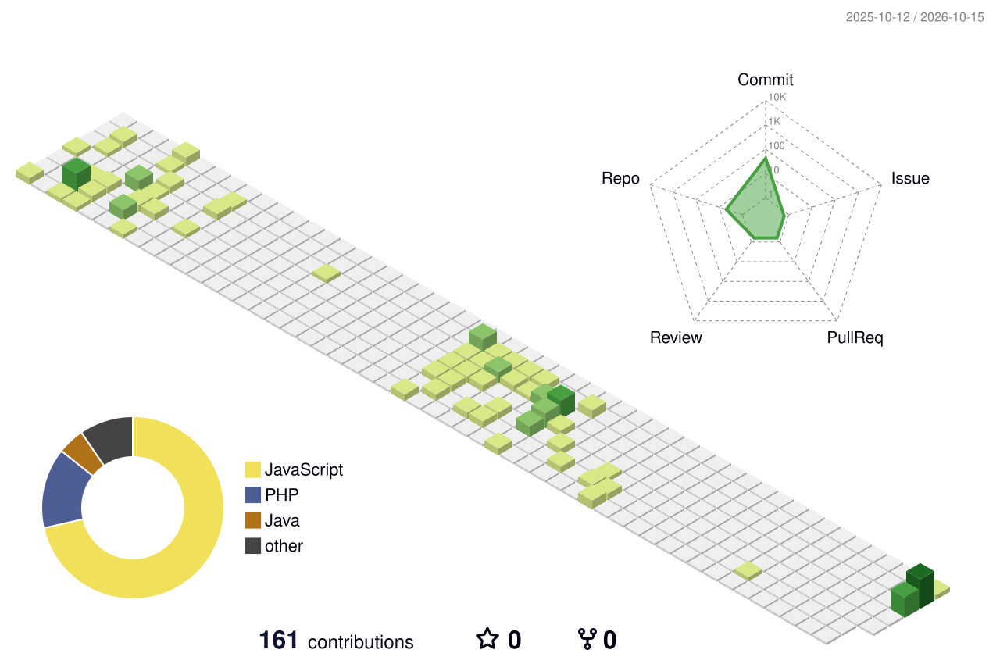

<h1>Oktariza Gunawan</h1>

Full-stack developer and Informatics student at Universitas Pamulang. I build web apps from the UI down to the database: React on the front, Laravel or Go on the back.

Most recently interned at **PT Amsar Prima Mandiri** as a Web Developer, building a sales and project-monitoring system used by 5 user roles (25 Laravel controllers, ~30 React pages, a separate dashboard per role).

Currently working on my thesis: an Android app that recommends over-the-counter first-aid medicine using content-based filtering.

### Stack

### Selected work

| Project | What it is | Built with |
| --- | --- | --- |
| kerja-praktek (private) | Sales and project-monitoring dashboard for PT Amsar Prima Mandiri, 5 user roles | Laravel 11, React, Zustand, Recharts |
| [portofolioterbaru](https://github.com/oktarizagunawan63/portofolioterbaru) | Personal portfolio, live at [oktariza.vercel.app](https://oktariza.vercel.app) | React 19, Tailwind, Framer Motion |
| [futsal_booking](https://github.com/oktarizagunawan63/futsal_booking) | Futsal court booking site with an admin panel | PHP, MySQL |
| [perpustakaan](https://github.com/oktarizagunawan63/perpustakaan) | Library system: catalog, member accounts, admin | PHP, MySQL |

### Contributions

<picture>
  <source media="(prefers-color-scheme: dark)" srcset="./profile-3d-contrib/profile-night-view.svg">
  
</picture>
